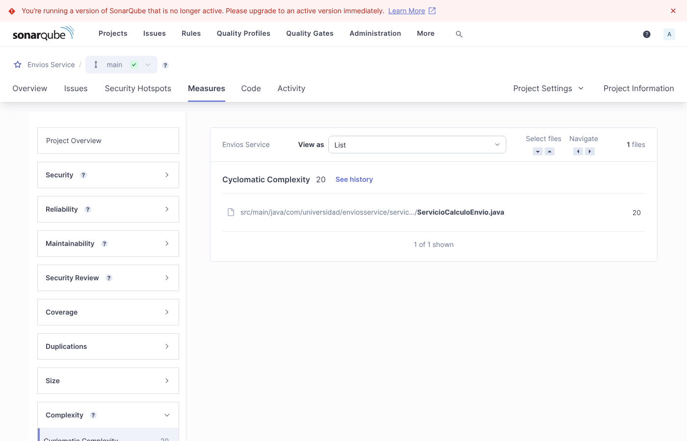
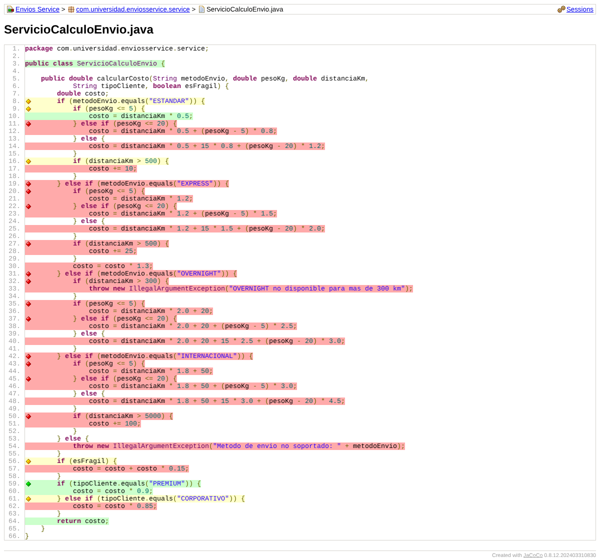
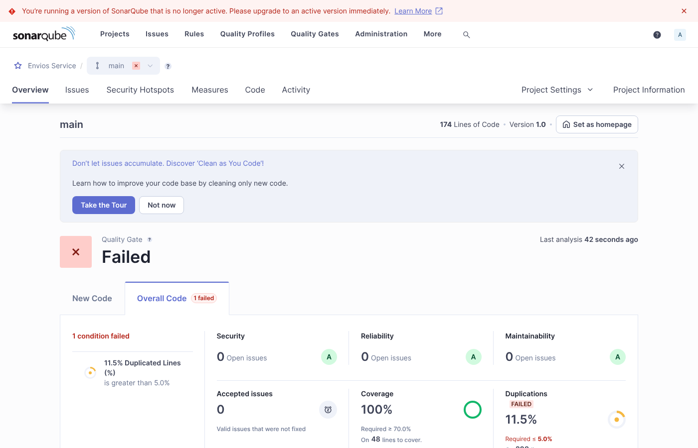
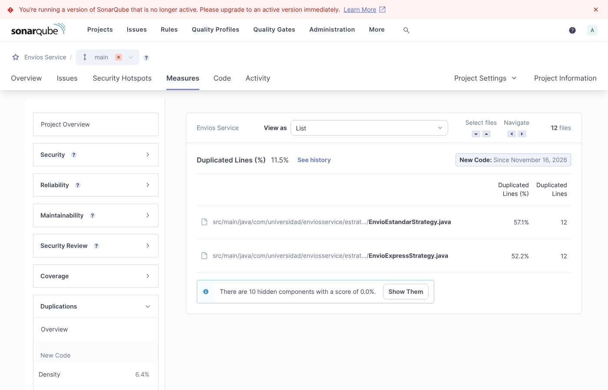
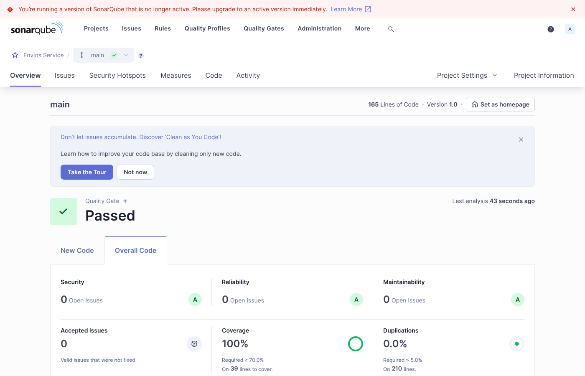
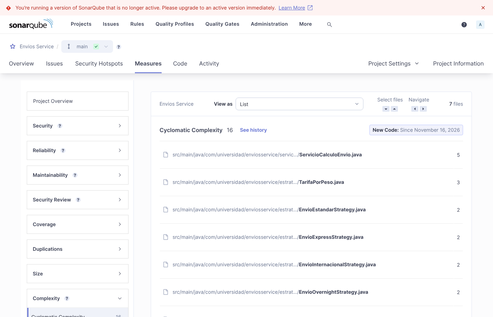
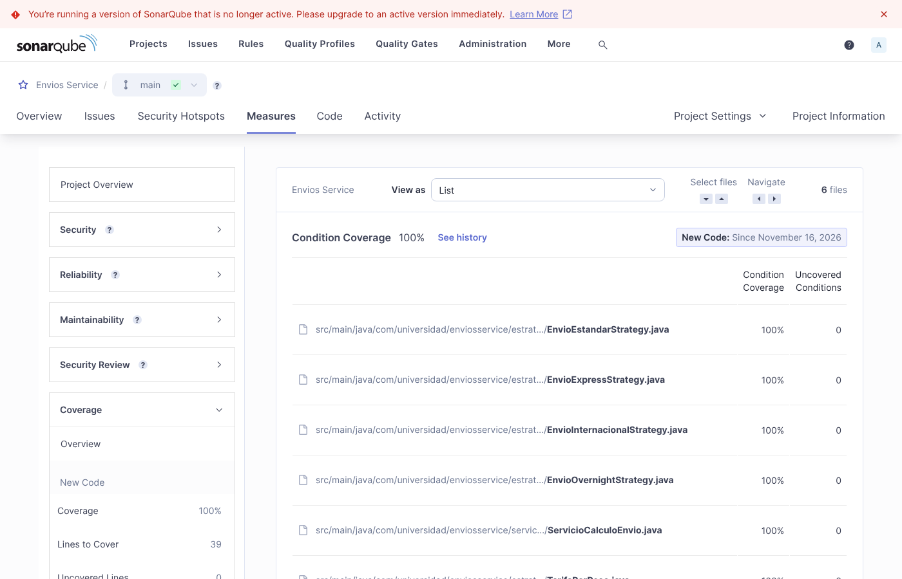
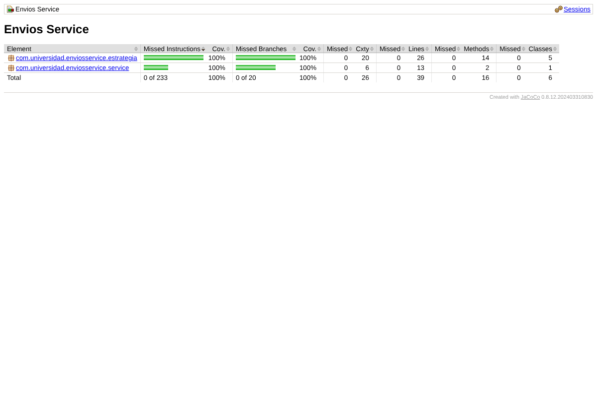
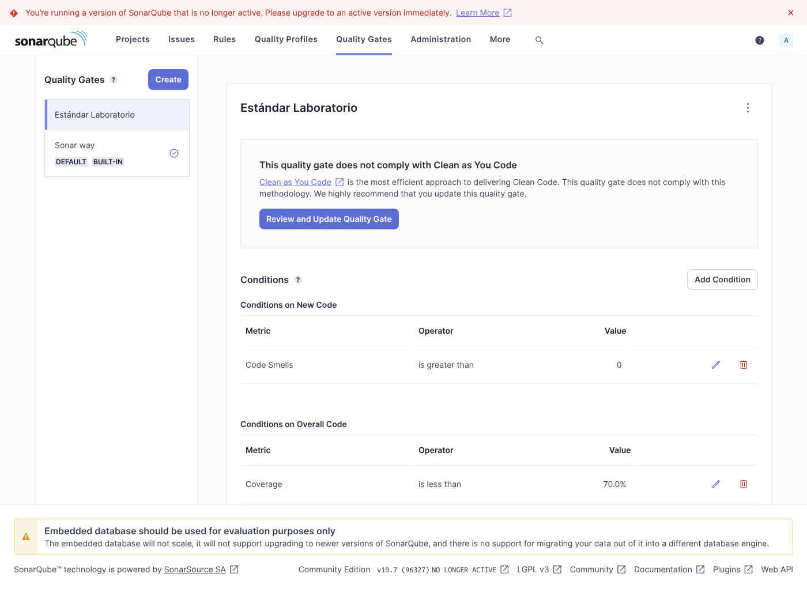
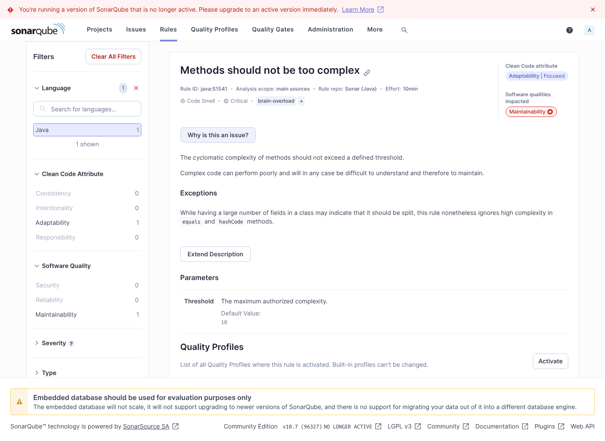

# Envios Service — Diagnóstico y Mejora Guiada por Métricas

**Universidad Francisco de Paula Santander — Ingeniería de Sistemas**
**Curso:** Patrones de Diseño de Software (1156701-A) — Post-contenido Unidad 10
**Estudiante:** Diego Armando Márquez Rigaud — **Código:** 1152115

## Descripción

Proyecto Maven plano (Java 21, sin Spring) que calcula el costo de un envío según método de transporte,
peso, distancia, fragilidad y tipo de cliente. La **Parte 1** configura SonarQube y JaCoCo sobre una clase
con un método deliberadamente complejo y una suite que cubre solo dos caminos, y documenta el reporte
real. La **Parte 2** aplica el patrón **Strategy**, agrega pruebas que cubren las ramas faltantes,
configura el Quality Profile y el Quality Gate **"Estándar Laboratorio"** y compara las métricas antes y
después con los datos de cada análisis.

```
├── pom.xml                         JUnit 5, JaCoCo 0.8.12 (prepare-agent + report), sonar-maven-plugin
├── sonar-project.properties        configuración equivalente para sonar-scanner CLI
├── docs/                           capturas de SonarQube y JaCoCo (inicial, intermedio y final)
└── src/
    ├── main/java/com/universidad/enviosservice/
    │   ├── service/ServicioCalculoEnvio.java        orquestador (CC 20 → 5)
    │   └── estrategia/                               EstrategiaEnvio + 4 estrategias + TarifaPorPeso
    └── test/java/com/universidad/enviosservice/      34 pruebas (2 iniciales + 32 nuevas)
```

## Entorno de análisis

SonarQube Community **10.7** ejecutado en **Docker local** (`sonarqube:10.7.0-community`,
`SONAR_ES_BOOTSTRAP_CHECKS_DISABLE=true`, puerto 9000). Proyecto `Envios Service`, key
`com.universidad:envios-service`, análisis con token de proyecto:

```bash
mvn clean verify sonar:sonar -Dsonar.token=TU_TOKEN
```

## Estado inicial del análisis (Parte 1)

Datos reales del primer análisis (perfil *Sonar way*), confirmados en *Measures* y en la API de SonarQube:

| Métrica | Valor real observado |
|---------|----------------------|
| Complejidad ciclomática de `calcularCosto()` | **20** (único método de la clase: la complejidad del archivo es la del método) |
| Complejidad cognitiva de `calcularCosto()` | **32** |
| Cobertura de líneas de `ServicioCalculoEnvio` | **23,8 %** (10 de 42 líneas) |
| Cobertura de ramas de `ServicioCalculoEnvio` | **18,4 %** (7 de 38 condiciones) |
| Code Smells reportados | **1** — `java:S3776` CRITICAL: *"Refactor this method to reduce its Cognitive Complexity from 32 to the 15 allowed"* |

### Interpretación

Las tres señales apuntan al **mismo método**, `calcularCosto()`, porque es el único que existe: concentra
la cadena de cuatro métodos de envío, los tramos de peso, los recargos por distancia y las reglas de
fragilidad y cliente. Las dos pruebas de partida solo recorren `ESTANDAR` con peso ≤ 5 kg y distancia ≤
500 km (con cliente REGULAR y PREMIUM). En el reporte HTML de JaCoCo
(`docs/jacoco-fuente-servicio-inicial.png`) quedan en rojo o amarillo:

- toda la rama **EXPRESS** (líneas 19–30), **OVERNIGHT** con su excepción por > 300 km (31–41) e
  **INTERNACIONAL** con su recargo por > 5000 km (42–52);
- los tramos **5–20 kg** y **> 20 kg** de ESTANDAR (11–14) y su recargo por **> 500 km** (16–17);
- el **método no soportado** (53–54), el recargo por **fragilidad** (56–57) y el descuento
  **CORPORATIVO** (61–62).






## Decisiones de diseño

1. **Entorno de análisis: SonarQube local con Docker.** (a) *Control total de la configuración*: el
   laboratorio exige duplicar el perfil *Sonar way*, activar `java:S1541` con umbral 10 y crear un
   Quality Gate propio; en local todo eso se hace como administrador sin restricciones de organización ni
   de plan. (b) *Sin dependencia de conectividad ni de límites del plan gratuito*, y sin dejar público el
   análisis de un proyecto académico (en SonarCloud los proyectos gratuitos son públicos). El costo
   aceptado fue mantener el contenedor encendido durante todo el laboratorio (~2 GB de RAM) y que el
   dashboard no sea accesible desde otro equipo, por eso las capturas quedan en `docs/`.
2. **Exclusiones del análisis: ninguna.** El proyecto no tiene clase de arranque (`Main`), DTOs generados
   ni código de infraestructura: todas las clases contienen lógica de negocio cuya cobertura sí importa.
   Excluir algo solo maquillaría el porcentaje. Si el proyecto creciera con un `Main` sin lógica, se
   agregaría `sonar.exclusions=**/Main.java` (queda comentado en `sonar-project.properties`).
3. **Métrica usada como señal principal: complejidad ciclomática.** Es la que el laboratorio pide reducir
   (≥ 50 %) y la que se puede limitar por método con la regla S1541; además, la CC es el número mínimo de
   caminos independientes que una suite debe ejercitar, así que conecta directamente con la cobertura de
   ramas (38 condiciones, 7 cubiertas). La complejidad cognitiva (32) confirmó el diagnóstico y mide mejor
   la dificultad de lectura por el anidamiento, pero no tiene una relación directa con el número de
   pruebas necesarias. La cobertura por sí sola no elige método: una clase simple sin pruebas también
   tendría cobertura baja.
4. **Patrón elegido: Strategy.** El método **no guarda estado entre llamadas** (cada invocación depende solo
   de sus parámetros y no hay transiciones entre estados), lo que descarta **State**. Tampoco hay **una
   secuencia de manejadores donde el orden importe y varios puedan aplicar**: el `metodoEnvio` selecciona
   exactamente **una** rama, una sola vez, y las ramas no se encadenan, lo que descarta **Chain of
   Responsibility**. Cada rama calcula el **mismo tipo de resultado** (un costo) con **una fórmula propia**,
   elegida por un valor discreto: la definición de Strategy. Qué se movió y qué se quedó: las fórmulas por
   tramos y los recargos propios de cada método (incluida la excepción de OVERNIGHT y el factor 1,3 de
   EXPRESS) pasaron a su estrategia; **fragilidad y tipo de cliente se quedaron en el orquestador** porque
   son reglas transversales a los cuatro métodos: meterlas en cada estrategia las duplicaría cuatro veces.
   Por eso `calcularCosto()` queda en CC 5 y no en 1. Tras el primer re-análisis, el Quality Gate falló por
   duplicación (11,5 %): las cuatro estrategias repetían la estructura de tramos. Se extrajo el Value Object
   `TarifaPorPeso` (tarifa por km, cargo fijo y tarifa por kg de cada tramo) sin cambiar ninguna fórmula; las
   estrategias quedaron en CC 2 y la duplicación en 0 %.
5. **Criterio de pruebas agregadas.** Cada prueba nueva corresponde a una rama roja/amarilla del reporte
   inicial y verifica un valor distinto calculado a mano:

   | Rama sin cubrir en la Parte 1 (líneas) | Prueba nueva que la ejercita |
   |---|---|
   | ESTANDAR 5–20 kg (11–12) y > 20 kg (13–14), límites 5 y 20 kg | `EnvioEstandarStrategyTest` (52,4 · 68,0 · 50,0 · 62,0) |
   | ESTANDAR recargo > 500 km (16–17) y caso 500 km sin recargo | `EnvioEstandarStrategyTest` (310,0 · 250,0) |
   | EXPRESS completo: tres tramos, recargo > 500 km y factor 1,3 (19–30) | `EnvioExpressStrategyTest` (156,0 · 161,85 · 198,25 · 968,5) |
   | OVERNIGHT: tres tramos, límite 300 km y excepción > 300 km (31–41) | `EnvioOvernightStrategyTest` (220,0 · 227,5 · 272,5 · 620,0 · excepción con mensaje) |
   | INTERNACIONAL: tres tramos y recargo > 5000 km (42–52) | `EnvioInternacionalStrategyTest` (230,0 · 239,0 · 297,5 · 10950,0 · 9050,0) |
   | Método no soportado (53–54) | `rechazaMetodoDeEnvioNoSoportado` (verifica el mensaje) |
   | Fragilidad (56–57) | `aplicaRecargoPorFragilidad` (57,5) y `fragilidadSeAplicaAntesDelDescuentoDelCliente` (51,75) |
   | Descuento CORPORATIVO (61–62) | `aplicaDescuentoClienteCorporativo` (42,5) |
   | Delegación del orquestador en cada estrategia | `delegaEnLaEstrategiaDelMetodo` (EXPRESS, OVERNIGHT, INTERNACIONAL) |
   | Límites de los tramos en `TarifaPorPeso` | `TarifaPorPesoTest` (5,0 · 5,5 · 20,0 · 21,0 kg) |

   Nota: el ejemplo del enunciado esperaba 250,0 para OVERNIGHT con 25 kg y 100 km; el valor correcto según
   la fórmula original es 200 + 20 + 15 × 2,5 + 5 × 3,0 = **272,5**, que es el que se verifica (la
   refactorización no puede cambiar el resultado del código original).
6. **Realismo del Quality Gate.** **CC = 10 por método** (regla `java:S1541`, Threshold 10, en el perfil
   "Estándar Laboratorio") porque es el techo del rango *Moderada* de la Tabla 3.2 de la guía y el valor por
   defecto que propone SonarQube: con 5 obligaría a fragmentar métodos que aún se leen bien (el orquestador
   tiene 5) y con 20 el método original habría pasado. **Cobertura mínima de 70 %** y no 100 %: el 100 % suele
   producir pruebas triviales solo para llenar el número (Sección 2.3, incentivos perversos), mientras que
   70 % deja margen para código de infraestructura sin obligar a "mentir con pruebas vacías"; aquí se
   alcanzó 100 % porque toda la clase es lógica de negocio, no porque el umbral lo exigiera. **Duplicación
   máxima de 5 %**, que resultó ser la condición más útil: detectó la duplicación que introdujo la primera
   versión del refactor. **New Code Smells > 0** bloquea cualquier método nuevo o modificado con CC > 10.
   Al crear el gate, SonarQube 10.7 agrega condiciones *Clean as You Code* por defecto; se eliminaron para
   dejar exactamente las tres condiciones del laboratorio.

## Comparación antes / después

| Métrica | Antes (Parte 1) | Intermedio (solo Strategy) | Después (Parte 2) |
|---------|-----------------|----------------------------|-------------------|
| Complejidad ciclomática de `calcularCosto()` | 20 | 5 | **5 (−75 %)** |
| CC máxima de un método del proyecto | 20 | 5 | **5** (estrategias 2, `TarifaPorPeso` 3) |
| Complejidad cognitiva total | 32 | 19 | **10** |
| Cobertura de ramas de la lógica de envío | 18,4 % (7/38) | 100 % | **100 % (20/20), +81,6 pp** |
| Cobertura de líneas | 23,8 % | 100 % | **100 %** |
| Duplicación | 0,0 % | 11,5 % | **0,0 %** |
| Code Smells | 1 (S3776) | 0 | **0** |
| Quality Gate "Estándar Laboratorio" | — (aún no existía) | **Failed** (duplicación 11,5 % > 5 %) | **Passed** |

El número de condiciones a cubrir bajó de 38 a 20 porque la duplicación de tramos desapareció: la misma
lógica de tramos ahora se prueba una vez en `TarifaPorPeso` y no cuatro veces.

## Capturas

**Inicial**


**Intermedio — el Quality Gate falla por duplicación**



**Final**





**Configuración**



## Cómo ejecutar

```bash
docker run -d --name sonarqube -p 9000:9000 -e SONAR_ES_BOOTSTRAP_CHECKS_DISABLE=true sonarqube:10.7.0-community
mvn clean verify                                  # 34 pruebas + target/site/jacoco/index.html
mvn clean verify sonar:sonar -Dsonar.token=TU_TOKEN
```

## Herramientas utilizadas

- Java 21, Apache Maven, JUnit 5 (pruebas parametrizadas)
- SonarQube Community 10.7 (Docker), JaCoCo 0.8.12
- Git, GitHub

## Conclusiones

Medir antes de refactorizar convirtió una impresión ("este método es largo") en datos: CC 20, complejidad
cognitiva 32 y 18,4 % de ramas cubiertas, todo en `calcularCosto()`. Elegir el patrón por la naturaleza de
los condicionales (selección única de una fórmula, sin estado ni cadena) llevó a Strategy y redujo la CC del
método en 75 %, dejando en el orquestador solo las reglas transversales. Las pruebas nuevas se diseñaron rama
por rama a partir del reporte de JaCoCo, por eso la cobertura subió sin pruebas de relleno. El Quality Gate
aportó algo que la intuición no vio: la primera versión del refactor duplicaba código, y fue la condición de
duplicación la que obligó a extraer `TarifaPorPeso`.
