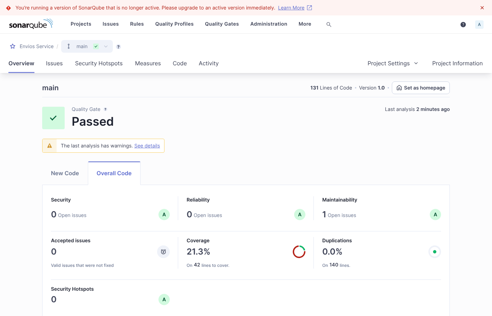
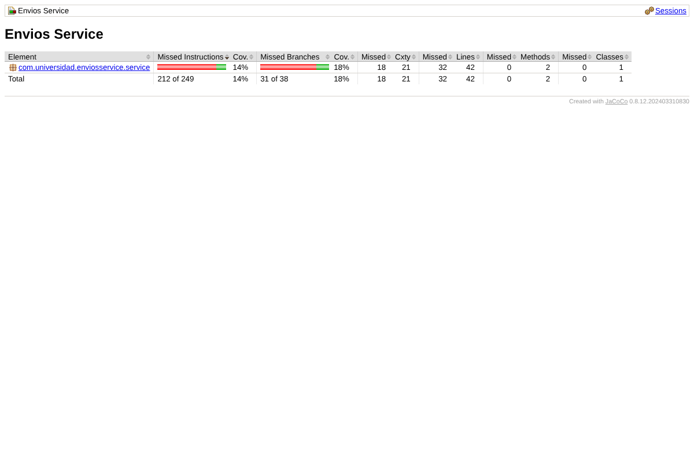

# Envios Service — Análisis de Métricas de Calidad

**UFPS — Patrones de Diseño de Software (1156701-A) · Post-contenido Unidad 10**
**Estudiante:** Diego Armando Márquez Rigaud — **Código:** 1152115

## Entorno de análisis

SonarQube Community 10.7 local con Docker (`sonarqube:10.7.0-community`), proyecto `envios-service`,
key `com.universidad:envios-service`. Ver Decisión de diseño 1 en la versión final de este README.

## Estado inicial del análisis

| Métrica | Valor real observado |
|---------|----------------------|
| Complejidad ciclomática de `calcularCosto()` | 20 |
| Complejidad cognitiva de `calcularCosto()` | 32 |
| Cobertura de líneas de `ServicioCalculoEnvio` | 23,8 % (10 de 42) |
| Cobertura de ramas de `ServicioCalculoEnvio` | 18,4 % (7 de 38) |
| Code Smells reportados | 1 (`java:S3776`, CRITICAL) |

## Interpretación

`calcularCosto()` es el único método de la clase y concentra toda la complejidad (CC 20) y toda la falta
de cobertura: las dos pruebas de partida solo recorren `ESTANDAR` con peso ≤ 5 kg y distancia ≤ 500 km.
JaCoCo deja sin ejecutar las ramas de EXPRESS, OVERNIGHT (incluida la excepción por > 300 km),
INTERNACIONAL, los tramos de peso 5–20 kg y > 20 kg, los recargos por distancia, la fragilidad, el
descuento CORPORATIVO y el método no soportado.

